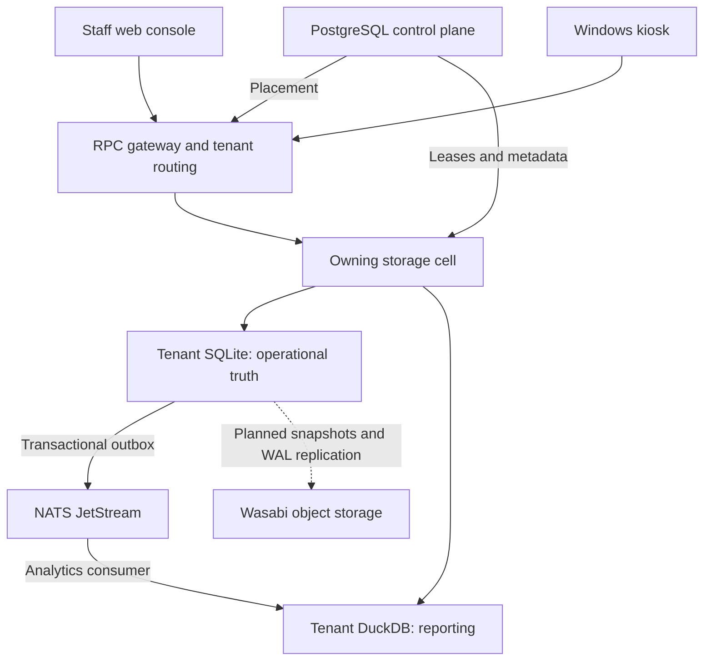

# Arena360 — Product and Technical Vision

> Give gaming café owners and their teams one dependable system to run every station, serve every player, and account for every sale—from opening the venue to closing the cash register.

| Document field | Value |
| --- | --- |
| Purpose | The maintained overview of the product, technical direction, current capabilities, limits, and launch priorities |
| Last reviewed | 2026-10-15 |
| Initial source baseline | `efdf481997fc` on `main` |
| Recorded platform milestone | M7 complete; M8 replication and recovery pending |
| Evidence scope | Repository source, tests, accepted ADRs, and implementation plans; production state was not inspected |
| Maintainers | Product owner and contributors changing the affected behavior |

This is a living overview. Source code governs actual behavior; accepted ADRs record architectural decisions; milestone plans record delivery status. Resolve disagreements by inspecting the implementation and updating the affected documentation together.

**Status language:** **Implemented** means source exists, not that a production deployment was verified. **Accepted direction** means an agreed architectural target that may remain unfinished. **Proposed strategy** means product interpretation requiring owner or customer validation. Test results quoted from milestone records are historical evidence, not fresh test runs.

## Contents

1. [Product purpose and positioning](#1-product-purpose-and-positioning)
2. [Customers, users, and outcomes](#2-customers-users-and-outcomes)
3. [The venue operating journey](#3-the-venue-operating-journey)
4. [Product capabilities](#4-product-capabilities)
5. [Product principles and experience](#5-product-principles-and-experience)
6. [Analytics and decision support](#6-analytics-and-decision-support)
7. [Commercial direction and success signals](#7-commercial-direction-and-success-signals)
8. [Technical purpose and system shape](#8-technical-purpose-and-system-shape)
9. [Tenant isolation, ownership, and scaling](#9-tenant-isolation-ownership-and-scaling)
10. [Transactions and data correctness](#10-transactions-and-data-correctness)
11. [Events, realtime, and analytics](#11-events-realtime-and-analytics)
12. [Identity, authorization, and station security](#12-identity-authorization-and-station-security)
13. [Kiosk continuity and lifecycle](#13-kiosk-continuity-and-lifecycle)
14. [Delivery, operations, and verification](#14-delivery-operations-and-verification)
15. [Roadmap and launch gates](#15-roadmap-and-launch-gates)
16. [Boundaries, open decisions, and risks](#16-boundaries-open-decisions-and-risks)
17. [Source map](#17-source-map)
18. [Maintenance contract and hook](#18-maintenance-contract-and-hook)
19. [Maintenance history](#19-maintenance-history)

## 1. Product purpose and positioning

### Mission

Arena360 connects gaming access, customer service, retail activity, stock, and financial responsibility in one venue workflow. It should help staff operate a normal day consistently and help owners understand the resulting records.

The core product loop is:

```text
Configure the venue → sell access → start play → serve the player
         → fulfill purchases → close and reconcile → review performance
```

The strongest product value is the connection between these steps: a purchase grants the correct time or consumes the correct stock; a session consumes the player's entitlement; a cash transaction belongs to an accountable operational context; management can inspect the outcome.

### Proposed positioning

An integrated operations platform for gaming cafés with Windows gaming PCs, prepaid gaming time, counter staff, and food or beverage sales.

The initial product focus should be dependable daily operations for individual venues, with organization and location controls supporting businesses that run several venues. Enterprise-chain readiness requires deployment, capacity, and customer validation beyond the existence of location settings.

### Intended long-term outcome

Owners can expand their business while retaining consistent pricing, access control, operational records, and visibility. Staff can complete routine work with clear responsibility and limited intervention. Players receive a consistent station experience with understandable remaining time and access to venue services.

## 2. Customers, users, and outcomes

These are product personas; authorization combines account roles, permission grants, and location scope.

| Persona | Desired outcome | Main interactions |
| --- | --- | --- |
| Owner / organization administrator | Control the business and understand performance | Locations, access, pricing, settings, financial reports, analytics |
| Venue manager | Keep the venue running and resolve exceptions | Stations, staff activity, stock, procurement, approvals, reconciliation |
| Counter staff | Serve customers accurately and quickly | Player registration, plans, POS, sessions, orders, shifts, registers |
| Kitchen / preparation staff | Receive clear preparation work and fulfill it | Ticket queue, preparation status, ready/served transitions |
| Player | Start playing and understand available time | Kiosk registration/sign-in, session display, game launcher, ordering |
| Platform operator | Provision and maintain independent businesses | Tenant setup, entitlements, ownership, migrations, service health, recovery |

The shared account roles are `admin`, `staff`, and `player`. Fine-grained permissions cover operations such as publishing pricing, reconciling registers, approving waste, receiving procurement, and managing access. See [shared permissions](packages/contracts/src/roles.ts).

## 3. The venue operating journey

### Prepare

Register stations and locations; configure games, plans, products, recipes, pricing, inventory, and staff grants. Organization defaults and location overrides let the business share configuration while controlling local differences.

### Open

Staff authenticate and establish the shift/register context required by their operational actions. Opening balances and responsibility should be explicit.

### Admit and sell

Identify or register the player, select an eligible plan or balance, record payment, and grant purchased gaming time. Enforce validity, device eligibility, time windows, and location availability on the server.

### Play

Start or resume the player's session on the station. Show remaining time and relevant restrictions. Launch approved software. Give staff live visibility into station/session changes.

### Serve

Accept station orders and counter purchases, record their financial state, consume stock, and enqueue preparation work where configured. Preserve the original sale and product context.

### Resolve exceptions

Handle insufficient stock, expired plans, session conflicts, failed payments, credit limits, concurrent edits, connection interruptions, and permission denials with explicit outcomes and recoverable actions.

### Close and learn

End sessions, settle credit, hand over or close shifts, reconcile cash, review deposits and expenses, and inspect performance. Operational exceptions should remain traceable.

## 4. Product capabilities

The following capabilities are implemented in the repository. Their presence is not a certification of production readiness.

| Domain | Current capability | Important boundary |
| --- | --- | --- |
| Players | Registration, profiles, account status, passwords, balances, and credit details | Staff credentials are global; player operations are tenant-local |
| Plans and wallets | Time credits, validity, device restrictions, allowed periods, balance purchases/recharges, staff gaming allowances | Prepaid time is not automatically a recurring subscription |
| Pricing | Base prices, location scope/overrides, draft/validate/simulate/publish policy workflows, scheduled activation, deduction rules | Scenario analysis does not automatically optimize live prices |
| Sessions | Start, resume, heartbeat, end, time consumption, expiry caps, session conflicts | The backend owns the accounting; the kiosk countdown is a projection |
| Stations | Provisioning, fingerprints, status management, and live floor view | Hardware behavior needs Windows deployment verification |
| Games and kiosk | Local approved-software configuration, game library, launches, process tracking/cleanup, staff setup | Application lockdown works within Windows security boundaries |
| Sales | Plan and product transactions, payment states, cash/online splits, sale snapshots | Payment recording does not establish a complete payment-acquirer integration |
| Credit | Limits, outstanding balances, partial settlements, settlement history | Collections and sales have different reporting meanings |
| Orders and kitchen | Kiosk ordering, order handling, preparation configuration, queued/preparing/ready/served ticket flow | Cancellation and refunds/stock restoration are separate business actions |
| Recipes and options | Made-to-order recipes, product option groups, ingredient selections, checkout consumption | Recipe shape and nesting restrictions are enforced by the service |
| Inventory | Locations, stock, movements/count adjustments, receipts, transfers, waste, and reorder rules | Venue locations and inventory storage locations have different meanings |
| Procurement | Vendors, purchase orders, approvals, fulfillment/receipts, financial links | Purchasing and stock records must reconcile with receipt outcomes |
| Staff and cash | Shifts, handover, registers, opening/closing balances, deposits, expenses, approvals, variance | Session logout does not itself close financial work |
| Business controls | Module permissions, location grants, settings inheritance, revisions, audit reasons/history, notifications | Client-side controls supplement server authorization |
| Reporting | Operational dashboards, financial reports, inventory/credit summaries, advanced business analytics | Asynchronous projections, date contracts, and metric limits apply |

Primary implementation references: [admin routes](apps/admin/src/App.tsx), [venue repositories](apps/backend/src/repositories/tenant_venue_repo.rs), [commerce repositories](apps/backend/src/repositories/tenant_commerce_repo.rs), [inventory repositories](apps/backend/src/repositories/tenant_inventory_repo.rs), [finance repositories](apps/backend/src/repositories/tenant_finance_repo.rs), and [recipe service](apps/backend/src/services/product_recipe_service.rs).

### Pricing and time consumption

Purchase prices and prepaid-time consumption are separate mechanisms. Plans can consume wallet minutes at different rates during configured periods. A session captures a deduction-profile snapshot, including the relevant rules and timezone, so later configuration changes do not silently replace its charging basis.

The product should explain the relationship between wallet credits and effective remaining play time. See [session service](apps/backend/src/services/session_service.rs) and [deduction calculation](apps/backend/src/services/deduction_profile.rs).

### Kitchen and stock

Completed/credit sales can create preparation work atomically with checkout, while pending sales enqueue on completion. Recipe and option selections can drive ingredient consumption. Preparation status, payment status, and inventory effects must retain their separate meanings. Older admin documentation predates some tenant/recipe implementation and must be checked against source.

## 5. Product principles and experience

1. **Keep the venue operating.** Reporting, caching, and background work should not unnecessarily interrupt transactions or active play.
2. **Explain money and time.** Show clear prices, entitlements, expiry, consumption, settlement, and reconciliation outcomes.
3. **Make responsibility visible.** Preserve actors, shift context, approvals, reasons, and history where the workflow requires them.
4. **Enforce rules at the server.** Availability, permission, stock, credit, and session checks remain authoritative beyond the UI.
5. **Recover from ordinary failures.** Preserve drafts where appropriate, expose revision conflicts, support safe retries, and distinguish completed work from failed work.
6. **Keep routine work short.** Reuse consistent list/detail/form patterns, searchable navigation, and guided review for consequential actions.
7. **Preserve accessibility.** Labels, keyboard access, contrast, responsive layouts, and understandable errors are part of the operating experience.

The admin console includes permission-aware navigation, guided forms, review steps, configurable appearance, and live query refresh. Appearance preferences are account/browser preferences, not organization settings. See [admin workspace guidance](apps/admin/README.md).

## 6. Analytics and decision support

### Purpose

Help owners understand observed activity and explore operating decisions while making assumptions and missing evidence visible.

| Workspace | Questions it supports | Interpretation limits |
| --- | --- | --- |
| Executive overview | What was sold, how much play occurred, and who returned? | Sales and credit collection differ; some counts are current snapshots |
| Location performance | How is usage distributed across recorded device areas? | Area labels do not establish full branch revenue attribution |
| Busy hours and capacity | When are stations occupied and where is spare capacity? | Capacity uses inventory and operating-window assumptions; waiting demand is unobserved |
| Revenue opportunity | What could an assumed improvement in utilization produce? | A gross scenario, not observed lost revenue or profit |
| Dynamic pricing | How do specified price/utilization scenarios compare? | No validated elasticity or automatic price changes |
| Customer retention | Who is new, returning, or absent under the stated rules? | Sessions and visit-days have different grains; detail limits apply |
| Membership analytics | Which prepaid wallets are active and which plans are bought again? | Does not establish MRR, true renewals, or exact historical entitlement utilization |
| Station performance | How much recorded play occurs at each station? | Allocated revenue is modeled; current status is not downtime history |
| Food and beverage / POS | Which products sell and which visitors also buy POS? | Customer-period attachment differs from session-level attachment |
| Staff / operations | What activity is attributed to staff and overlapping shifts? | No demand/role adjustment or inferred misconduct |
| Forecast / recommendations | What do recent weekday patterns and explicit rules suggest? | Historical ranges are not confidence intervals; accuracy is not validated |

See [analytics definitions and limits](docs/architecture/analytics.md#advanced-analytics-workspace). Current source and parity tests govern conflicts with older prose.

### Reporting contracts

- Normal business analytics use tenant calendar dates and bounded date ranges.
- Financial exports retain their documented UTC date contract and exact decimal strings.
- Reports are asynchronous views; a response-generation timestamp is not an ingestion watermark.
- Current receivables and current inventory should not be described as historical snapshots.
- Operational financial reports support venue control. Statutory accounts, recognized revenue, tax reporting, and a general ledger require additional capabilities.

## 7. Commercial direction and success signals

### Proposed commercial direction

The repository contains tenant subscription, licence, and signed-entitlement foundations. A business/location/station-based subscription could fit this product, but pricing, automated billing, customer acquisition, support economics, and willingness to pay remain commercial decisions requiring validation.

Initial customer work should validate the full venue-day workflow, onboarding effort, hardware compatibility, exception recovery, and the owner's willingness to rely on the records.

### Success signals to measure

| Outcome | Useful evidence |
| --- | --- |
| Reliable play | Session interruptions, failed starts, unexpected ends, recovery success |
| Faster service | Checkout completion, registration effort, order preparation/fulfillment time |
| Accountable money | Explainable register variance, settlement correctness, shift-close completion |
| Reliable inventory | Stock reconciliation, receipt accuracy, unexplained adjustments/waste |
| Manageable stations | Provisioning success, update success, launcher failures, support interventions |
| Product adoption | Completed onboarding, ongoing venue usage, owner intervention, support burden |
| Commercial sustainability | Conversion, retention/renewal, revenue per business, cost to serve |

These are proposed measurement areas. Establish baselines and definitions before setting numerical targets or making performance claims.

## 8. Technical purpose and system shape

### Technical vision

Run each business on isolated, transactional operational storage; derive its reports independently; route requests to one valid owner; and make infrastructure replaceable through verified recovery and tenant movement.

### Applications and shared code

| Surface | Technology | Responsibility |
| --- | --- | --- |
| `apps/admin` | React, TypeScript, Vite, MUI, TanStack Query | Staff/admin operations console |
| `apps/kiosk` | Tauri 2, React, native Rust | Windows station experience and OS integration |
| `apps/backend` | Rust, Axum, Tokio, SQLx | Authentication, business rules, persistence, realtime, reporting, workers |
| `packages/contracts` | TypeScript | Shared roles, permissions, errors, and domain contracts |
| `packages/proto` | Protobuf-generated TypeScript and transport | RPC/realtime client contracts |
| `packages/api-types` | Generated API schema types | Existing API type surface |
| Other shared packages | UI, theme, providers, utilities, tooling configuration | Consistency across clients |

The workspace uses pnpm and Turborepo for the JavaScript applications/packages. The backend is Cargo-managed. Reuse established layers and contracts; grow deployment separation only when required by ownership, load, or operating needs.

### Logical architecture



### Process roles

One backend binary supports `control`, `router`, and `cell` roles. The initial deployment combines them; role boundaries allow later separation.

- **Control:** tenant registry, global staff identities, membership metadata, subscriptions/licensing, placement, and ownership.
- **Router:** resolve the owning cell and forward tenant traffic.
- **Cell:** tenant business APIs, realtime, DuckDB reports, and tenant workers.

See [role configuration](apps/backend/src/config/roles.rs) and [application wiring](apps/backend/src/app.rs).

### Transport

The client transport uses a protobuf/gRPC-web gateway that adapts requests into the internal application router. The adapter preserves existing validation, authorization, and error behavior. Its payload still carries application request/response data; the transport should not be described as a wholly independent set of strongly typed domain RPC methods.

Normal production configuration disables public legacy business REST. WebSocket realtime uses protobuf frames. See [RPC adapter](apps/backend/src/rpc.rs), [client transport](packages/proto/src/transport.ts), and [production values](infra/helm/backend/values-prod.yaml).

## 9. Tenant isolation, ownership, and scaling

### Business and location boundaries

A tenant represents one business/organization. Venue locations belong inside that boundary. Inventory locations represent stock storage and must not be substituted for business/venue identity.

PostgreSQL owns global control metadata and staff credentials. Each tenant owns separate SQLite and DuckDB files. Location-scoped authorization remains necessary within those files.

Physical separation removes dependence on a tenant predicate in every shared operational table. Authentication, routing, cache identity, events, and location permissions still require correct scoping.

### One writable owner

Tenant ownership uses control-plane leases and generations. The owning cell checks its right to write, including immediately before transaction commit. A stale owner must fence itself.

The accepted lease design uses a five-minute lease, renewal every minute, and self-fencing 30 seconds before measured expiry. Reassignment after failure waits for expiry plus a clock-skew margin. A prolonged control-plane outage therefore pauses writes; cached entitlements do not eliminate lease dependence.

These timings are design/configuration behavior, not a measured availability guarantee. See [lease decisions](docs/adr/0043-storage-cells-sqlite-duckdb.md#ownership-lease-owner-decision-2026-10-06) and [ownership tests](apps/backend/tests/ownership_fencing.rs).

### Scaling unit

Scale by placing tenants across storage cells. Each open tenant has one SQLite writer and bounded readers. Cells require persistent local storage, controlled tenant placement, resource admission, and migration coordination.

Capacity must be benchmarked with representative sessions, checkout, reporting, rebuilds, and failure conditions. The existing venue-day benchmark is a harness; it does not establish production capacity. Live tenant movement and cell draining remain M9 work.

## 10. Transactions and data correctness

### Atomic business changes

Mutations must commit their required business rows and canonical events together. Examples include:

- Sale, payment state, stock consumption, and purchased-time grant.
- Session state, wallet consumption, ledger records, and resulting events.
- Credit settlement, outstanding balance effects, and financial source entries.
- Receipt, inventory changes, procurement fulfillment, and linked financial records.
- Shift handover, register responsibility, and related audit records.

Tenant writes use immediate transactions and ownership checks. Failure must roll back dependent effects. Retries must preserve the idempotency guarantees of each operation. See [tenant writer](apps/backend/src/tenancy/db.rs) and [commerce atomicity coverage](apps/backend/tests/tenant_commerce_repositories.rs).

### Storage conventions

| Concern | Convention |
| --- | --- |
| Identifiers | UUIDs; tenant storage conventions use Rust-generated UUID v7 text |
| Money | Scale-four fixed-point integers in SQLite; exact decimal processing where required |
| Time | Stored/transmitted UTC instants with fixed-width timestamp helpers |
| Calendars | Tenant IANA timezone derives reporting labels and date boundaries |
| JSON | Validated JSON text in tenant SQLite |
| Historical context | Immutable sale/session snapshots where the business operation requires them |
| Concurrency | Expected revisions, immediate transactions, bounded retries, and lease checks |

Some client DTOs still expose floating-point numeric presentation. Exact storage does not imply every client representation is decimal-safe. Financial CSV exports preserve exact decimal strings. See [value helpers](apps/backend/src/tenancy/values.rs) and [SQLite conventions](docs/adr/0043-storage-cells-sqlite-duckdb.md#sqlite-conventions).

## 11. Events, realtime, and analytics

### Transactional outbox

SQLite business transactions write canonical outbox events atomically. A publisher sends committed events to NATS JetStream and persists publication progress. Broker/network waits must not hold the operational writer.

JetStream supplies replay retention. Analytics uses tenant sequences, checkpoints, duplicate handling, and gap detection. Persistent gaps trigger recovery/rebuild rather than silently skipping records.

### Live operational views

The owning cell dispatches committed events in-process. Durable delivery, acknowledgments, source-tenant authorization, and reconnect behavior support client refresh. Admin queries also have polling/invalidation fallbacks; the kiosk handles its own session and device events.

Realtime delivery and analytical projection serve different purposes and may progress independently. See [tenant realtime transport](apps/backend/src/realtime/tenant_transport.rs), [publisher](apps/backend/src/analytics/publisher.rs), and [consumer](apps/backend/src/analytics/consumer.rs).

### Rebuildable reports

DuckDB is derived state. Rebuilds use a consistent private SQLite snapshot, a committed sequence boundary, and retained-event replay. Building a replacement must preserve the existing usable state on failure and respect ownership fencing.

Report readers enforce current grants, tenant calendars, schema/readiness state, and the hot-data boundary. Cache identity includes projection and ownership information. Rebuilding/disabled analytics returns `503 ANALYTICS_UNAVAILABLE`; operational APIs do not fall back to a shared reporting store.

Normal analytics is designed around an approximately 18-month hot window. Existing retention/sealed summaries must be distinguished from unfinished archival of operational history. Historical export and verified SQLite archival/purge remain M11.

See [rebuild implementation](apps/backend/src/analytics/rebuild.rs), [report reader](apps/backend/src/analytics/report_reader.rs), and [report readiness/access tests](apps/backend/tests/report_cutover.rs).

## 12. Identity, authorization, and station security

### Service access

- Validate token signature, identity, tenant, account state, and applicable current grants.
- Keep global staff credentials/MFA in the control plane and project secret-free operational identity/access information locally.
- Enforce module and location permissions in backend operations and reports.
- Separate panel, device, and player contexts; a station token must not implicitly grant staff operations.
- Scope realtime subscriptions/delivery and cached results to authorized identities and data.

See [authentication middleware](apps/backend/src/middleware/auth.rs), [access routes](apps/backend/src/access/routes.rs), and [staff projection](apps/backend/src/control/staff_projection.rs).

### Station security

The kiosk combines local launch allow-lists, native process management, keyboard/shell controls, and staff setup access. Backend session authorization remains separate from local OS enforcement.

Windows secure attention handling and some restrictions require supported OS features/configuration. A deployed kiosk needs a controlled Windows account and hardware verification. App hooks alone do not establish complete OS isolation.

Process cleanup can terminate applications with unsaved work. Setup, active sessions, restoration, and update transitions must retain their tested protection boundaries. Consult [native kiosk code](apps/kiosk/src-tauri/src) and the [Windows QA checklist](docs/kiosk-windows-qa-checklist.md).

## 13. Kiosk continuity and lifecycle

### Connection interruptions

The kiosk persists non-secret session/display state, maintains its countdown, and supports bounded offline grace. The default grace is five minutes. Failed session-end intents are queued locally and replayed for reconciliation; retries must not double-deduct time.

This does not establish fully disconnected player authentication, independent POS, or venue-wide offline operation. Tokens and persisted UI state have different storage/security roles.

See [session persistence](apps/kiosk/src/lib/sessionPersist.ts), [offline queue](apps/kiosk/src/lib/offlineQueue.ts), and [configuration](apps/kiosk/src/lib/config.ts).

### Installation and updates

The repository includes Windows installer/release workflows, signed updater artifacts, idle-only update behavior, startup/recovery behavior, and diagnostics. Updates must respect active play and restore appropriate recovery behavior after cancellation or failure.

Release automation and test coverage do not substitute for an installed Windows smoke test. See [release workflow](.github/workflows/kiosk-release.yml) and [update implementation](apps/kiosk/src/lib/updater.ts).

## 14. Delivery, operations, and verification

### Development and deployment

- pnpm/Turborepo coordinate frontend/package tasks; Cargo builds the backend and native kiosk code.
- Protobuf generation and API type generation support shared transport/contracts.
- Docker Compose supplies local control PostgreSQL, Redis, JetStream, and S3-compatible development storage.
- Helm and GitHub Actions define backend/frontend deployment and persistent tenant storage.
- Redis is optional; its no-op fallback preserves service operation when unavailable.
- Health endpoints, metrics, traces/logging, ingestion/backlog measures, and background admission metrics support diagnosis.

The current production values combine backend roles. Infrastructure files represent deployable configuration, not evidence of current live state.

### Verification strategy

Changes should use focused tests for the affected invariants, then the applicable repository checks. Important existing coverage includes tenant isolation/ownership, transaction rollback, exact values, sessions, credit/stock/cash effects, realtime authorization, analytics replay/rebuild, report parity, and kiosk behavior.

Useful commands include:

```bash
pnpm lint
pnpm typecheck
pnpm test
pnpm backend:test
pnpm backend:test:integration
pnpm backend:clippy
pnpm --filter @gaming-cafe/kiosk test:rust
```

Native analytics and infrastructure-backed gates require their documented features/services. Use disposable control databases and temporary tenant files for integration checks.

The M7 progress record reports 427 backend/control/live checks plus 13 admin analytics checks for that milestone. These are recorded results, not checks performed while creating this document. See [progress evidence](docs/plans/data-platform-progress.md#m7-completed).

## 15. Roadmap and launch gates

The following is the recorded platform roadmap, not a new schedule or delivery estimate.

| Stage | Outcome | Recorded state |
| --- | --- | --- |
| M0 | Baseline fixtures and groundwork | Complete |
| M1 | PostgreSQL control plane and identity/entitlements | Complete |
| M2 | Ownership, fencing, and routing | Complete |
| M3 | Tenant SQLite storage, provisioning, migrations, outbox | Complete |
| M4 | Core venue operations on tenant SQLite | Complete |
| M5 | Back-office cutover and operational PostgreSQL retirement | Complete |
| M6 | Tenant analytics ingestion and rebuild | Complete |
| M7 | DuckDB report cutover and parity | Complete |
| M8 | WAL replication, snapshots, restore, and cell-loss drills | Pending; paying-venue launch gate |
| M9 | Live tenant moves, cell draining, and measured capacity | Planned |
| M10 | Cold-tenant storage and hydration | Planned |
| M11 | Verified historical archive, purge, and export jobs | Planned |

See the [build plan](docs/plans/data-platform-build-plan.md) and [current progress](docs/plans/data-platform-progress.md).

### M8 accepted direction, still unfinished

- Spool SQLite WAL safely and upload immutable verified segments to Wasabi.
- Target uploads every two minutes or earlier at a size threshold.
- Create daily snapshots and snapshots around migrations.
- Encrypt/checksum snapshots and segments, preserving ownership-generation lineage.
- Retain the planned recovery history for 90 days.
- Restore from a verified snapshot and ordered WAL; test a full cell loss.
- Measure restore time and publish an achievable recovery/availability target.

Approximately two minutes of potential cell-loss writes and 90-day recovery history are targets, not current guarantees. Recovering a process from surviving local files is different from restoring after disk/server loss.

### Proposed product delivery priorities

1. Finish the recovery launch gate and demonstrate it with restore drills.
2. Validate installed Windows provisioning, sessions, lockdown, recovery, and updates.
3. Pilot the full venue day, including payment, stock, order, and shift exceptions.
4. Establish support/onboarding routines and measured operating baselines.
5. Add cell capacity/movement and later lifecycle work according to actual demand and data age.

## 16. Boundaries, open decisions, and risks

### Open owner decisions

The accepted ADR records two M8 prerequisites: backup/archive key handling (proposed per-tenant keys, destroyed on deletion) and the cell availability target (proposed single-node cells with recovery time established by drills). This overview does not approve those decisions.

### Product boundaries

- Financial reporting supports operational control; statutory accounting/tax capability is not established.
- Subscription/licence metadata does not establish complete customer billing automation.
- Pricing and utilization scenarios do not establish autonomous optimization.
- Current station state does not establish a historical downtime timeline.
- Customer-session records do not establish waiting demand or abandonment.
- Offline grace does not establish fully disconnected venue operation.
- Tenant routing/ownership foundations do not establish completed live tenant relocation or disaster recovery.
- No production capacity, availability, commercial pricing, or forecast-accuracy promise is established by this document.

### Material risks and responses

| Risk | Required response |
| --- | --- |
| Disk/cell loss before M8 | Complete and verify replication, snapshots, restore, and alerts before the planned paid launch |
| Split-brain ownership | Preserve lease/generation checks and self-fencing in requests, commits, and workers |
| Control-plane outage | Account for lease expiry and staff authentication needs; avoid unlimited-offline claims |
| Background work degrades operations | Preserve bounded admission and foreground transaction priority; measure production-like load |
| Analytics lag or drift | Preserve checkpoints, gap detection, readiness guards, parity checks, and rebuild recovery |
| Money/time interpretation differs across clients | Retain exact persisted values, historical context, and explicit presentation contracts |
| Windows behavior differs across machines | Test installed builds on supported editions, games/launchers, and update/failure paths |
| Documentation diverges from implementation | Review this overview with behavior changes; retain evidence links and explicit status language |

### Known documentation gaps at initial review

The README references missing `docs/SYSTEM.md`, `docs/DEVELOPMENT.md`, `docs/DEPLOYMENT.md`, and `docs/planning/README.md`. Its former product-vision link is replaced by this file. The kiosk README contains unresolved merge markers, and some older prose describes pre-cutover behavior. These gaps were observed, not repaired as part of creating the vision.

The superseded shared-table tenancy document and rejected Turso proposal are historical context. Use ADR-0043 and current source for the accepted persistence direction.

## 17. Source map

| Topic | Authoritative starting points |
| --- | --- |
| Workspace and applications | [README](README.md), [root package](package.json), [backend manifest](apps/backend/Cargo.toml) |
| Product routes and workflows | [Admin app](apps/admin/src/App.tsx), [admin guidance](apps/admin/README.md), [kiosk app](apps/kiosk/src/app/App.tsx) |
| Backend structure and transport | [App wiring/router](apps/backend/src/app.rs), [RPC gateway](apps/backend/src/rpc.rs), [protobuf contracts](apps/backend/proto/arena360/v1) |
| Access and identity | [Permissions](packages/contracts/src/roles.ts), [middleware](apps/backend/src/middleware/auth.rs), [control](apps/backend/src/control) |
| Sessions, plans, stations | [Session service](apps/backend/src/services/session_service.rs), [venue repository](apps/backend/src/repositories/tenant_venue_repo.rs) |
| Sales, credit, orders | [Commerce repository](apps/backend/src/repositories/tenant_commerce_repo.rs), [recipe service](apps/backend/src/services/product_recipe_service.rs) |
| Inventory, procurement, finance | [Inventory repository](apps/backend/src/repositories/tenant_inventory_repo.rs), [procurement service](apps/backend/src/services/tenant_procurement_service.rs), [finance repository](apps/backend/src/repositories/tenant_finance_repo.rs) |
| Storage architecture | [ADR-0043](docs/adr/0043-storage-cells-sqlite-duckdb.md), [architecture baseline](docs/architecture/data-platform.md), [tenant storage](apps/backend/src/tenancy) |
| Analytics definitions and processing | [Reporting guide](docs/architecture/analytics.md), [DuckDB schema](docs/architecture/duckdb-analytics-schema.md), [analytics implementation](apps/backend/src/analytics) |
| Windows behavior and release | [Native code](apps/kiosk/src-tauri/src), [QA checklist](docs/kiosk-windows-qa-checklist.md), [release workflow](.github/workflows/kiosk-release.yml) |
| Deployment | [Production backend values](infra/helm/backend/values-prod.yaml), [backend workflow](.github/workflows/deploy-production-backend.yml) |
| Readiness and roadmap | [Build plan](docs/plans/data-platform-build-plan.md), [progress](docs/plans/data-platform-progress.md) |

## 18. Maintenance contract and hook

### When to update

Update the affected sections in the same change when work changes product capabilities, a user workflow, metric meaning, an architectural boundary, security behavior, deployment expectations, a material limitation, or milestone/launch readiness.

Keep the current narrative accurate. Preserve detailed implementation/task history in its existing ADR or plan. Do not add a new competing vision file. Routine refactors, formatting, and tests that preserve the described behavior need no vision edit.

### How to update

1. Read the implementation and relevant tests, callers, and accepted decisions.
2. Update only affected sections and supporting links.
3. Distinguish implemented behavior, accepted plans, and proposals.
4. Update **Last reviewed** when performing the review; keep the initial source baseline as historical provenance.
5. Add a concise history row describing the actual change and evidence.
6. Report checks performed accurately; do not promote a plan into a verified capability.

[AGENTS.md](AGENTS.md#living-product-and-technical-vision) carries this standing instruction for repository work.

### Pre-commit reminder

The existing `simple-git-hooks` pre-commit entry invokes `scripts/pre-commit-biome.sh`, which runs [scripts/check-vision.sh](scripts/check-vision.sh) before the existing formatting checks. The hook reminds contributors to review this file when staged changes touch applications, shared packages, infrastructure, workflows, architecture/ADR/planning documents, or root workspace/deployment configuration.

It prints a non-blocking reminder when relevant paths are staged without `VISION.md`. It does not generate text, mutate the vision, validate semantic freshness, or require meaningless document churn. Staging the vision suppresses the reminder but does not prove review quality. Documentation-only deletion is not prevented by this reminder.

The hook is active in this checkout through the existing installed pre-commit entry. Other clones use the repository's existing `prepare`/`simple-git-hooks` installation. It can also be run manually against the staged index:

```bash
bash scripts/check-vision.sh
```

Git hooks can be skipped; maintaining the document remains a contributor responsibility.

## 19. Maintenance history

| Date | Change | Evidence / verification |
| --- | --- | --- |
| 2026-10-15 | Created the unified product/technical vision, recorded M7/M8 readiness and known limits, linked the README, and added maintenance instructions plus a pre-commit reminder | Initial repository review at `efdf481997fc`; hook behavior checked in a disposable Git repository; no application tests or live deployment inspection performed for this documentation change |
