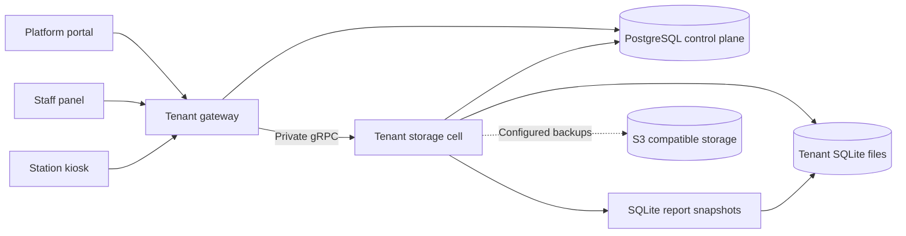
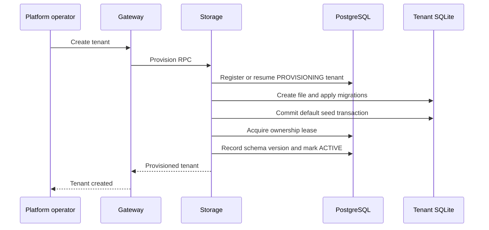

# Architecture

Arena360 uses two Rust services, a shared implementation crate, and separate portal, staff, and station applications. This document describes the current implementation. See [deployment](deployment.md) for hosting and [setup guidelines](setup-guidelines.md) for local configuration.

## System layout

Public REST and gRPC-Web APIs terminate at the gateway. Business requests and provisioning use private native gRPC to the owning storage cell. WebSocket traffic uses the existing streaming proxy. The platform portal's Nginx proxy forwards `/platform/*` to the gateway.

## Component ownership

| Component | Responsibilities | Source |
| --- | --- | --- |
| Tenant gateway | Platform APIs, control authentication, tenant ownership routing | [apps/tenant-gateway](../apps/tenant-gateway) |
| Tenant storage | Business operations, SQLite lifecycle, reports, leases, replication | [apps/tenant-storage](../apps/tenant-storage) |
| Shared core | Handlers, services, repositories, control plane, tenancy, analytics, realtime | [crates/backend-core](../crates/backend-core) |
| SQLite reporting | Bounded read snapshots and report functions | [crates/sqlite-reporting](../crates/sqlite-reporting) |
| Tenant protocol | Public API/realtime contracts and private storage contract | [crates/tenant-protocol](../crates/tenant-protocol) |
| Platform portal | Operators, plans, cells, tenants, initial business administrators | [apps/tenant](../apps/tenant) |
| Staff panel | Venue operations and tenant access management | [apps/admin](../apps/admin) |
| Station kiosk | Tauri station client | [apps/kiosk](../apps/kiosk) |
| Operator tools | Seeding, migrations/rollouts, recovery, moves, rebalancing | [tools/backend-cli](../tools/backend-cli) |

Entry points select the runtime role and start the shared core. Gateway roles are fixed to `control,router`; storage is fixed to `cell`. Gateway clears local cell ownership and creates no tenant database manager or provisioner. The compatibility launcher in `apps/backend` retains the combined process deployment.

Shared Rust code lives in `crates/` and must not depend on application or operator packages. Dependencies and the lockfile are shared at the workspace root. The kiosk's Tauri workspace has an independent release lifecycle.

## Data boundaries

| Store | Data | Access |
| --- | --- | --- |
| PostgreSQL | Tenants, staff credentials/memberships, subscriptions/licenses, cells, leases, platform operators, recovery/migration metadata | Gateway and storage |
| Tenant SQLite | Players, venue catalog, sessions, transactions, inventory, finance, settings overrides, roles, local staff projections, outbox | Owning storage cell |
| SQLite report snapshot | A consistent bounded view of the tenant operational database | Storage report reader |
| S3 compatible storage | Configured replication objects, snapshots, and historical artifacts | Storage and operator workflows |

Tenant databases live at `TENANT_DATA_DIR/tenant-<UUID>/operational.sqlite`. The file establishes the tenant boundary; tenant-local tables do not carry a shared `tenant_id` column. Staff profiles are projected into SQLite without global password hashes or TOTP secrets. Tenant-owned access assignments remain local when profiles refresh.

Storage still connects to PostgreSQL for ownership leases, projections, and lifecycle state. Business repositories operate on the tenant database, while control-dependent workflows retain that connection requirement.

## Request and write flow

1. The gateway authenticates the public request and resolves the tenant's current owner from control-plane routing metadata.
2. It forwards the operation to that cell through the private `TenantStorageService.Invoke` RPC, preserving scoped request headers and the user JWT.
3. Storage authenticates the private service token, checks the user and current tenant grants, and invokes the shared business handlers.
4. Repositories use the tenant's lease-fenced SQLite writer. Transactional writes serialize through that writer and use `BEGIN IMMEDIATE`.
5. Ownership is checked before writing and again before commit. A stale generation cannot commit the operation.
6. Business changes and their outbox rows commit together; the commit notifier makes the new event sequences available to realtime processing.

The private client reuses channels and applies connection/request deadlines. It does not automatically retry failed writes. Private service authentication is independent of the user's JWT. See [runtime](../crates/backend-core/src/runtime.rs), [storage RPC](../crates/backend-core/src/storage_rpc.rs), and [tenant database](../crates/backend-core/src/tenancy/db.rs).

## Tenant creation

Settings are validated before registration. Provisioning creates or resumes the same control-plane tenant, creates its file without replacing an existing database, applies embedded migrations, and commits its seeds before activation. PostgreSQL, SQLite, and the filesystem do not share one transaction; retries converge through this staged workflow.

The initial catalog contains eleven canonical units; Administrator, Counter operator, and Location administrator roles; and six templates: Venue manager, Counter operator, Kitchen operator, Finance reviewer, Auditor, and Location administrator. Administrator grants cover the access catalog, including location setup. Templates must be copied to assignable roles before they can grant access.

Platform setting defaults stay in the code-owned catalog. Only validated initial overrides are seeded. Retries preserve customized unit names, role permissions, and settings. Conflicting default names/IDs or an incompatible role/template type abort the seed transaction. Business administrator creation is a separate portal step after tenant creation. See [provisioning](../crates/backend-core/src/tenancy/provisioning.rs).

## Authentication and authorization

Platform operators use a separate account and session system with password login, authenticator enrollment, and subsequent TOTP verification. Platform sessions authorize `/platform/*` management APIs. Tenant business users authenticate through control-plane identity and receive scoped JWTs.

Storage uses current local roles, module settings, and venue assignments to enforce business access. Role templates confer no permissions directly. The shared permission catalog and route boundary live in [access](../crates/backend-core/src/access). The private RPC additionally requires the shared `STORAGE_SERVICE_TOKEN`.

Request throttling uses atomic in-process buckets. Each service replica enforces its own allowance. Operational reads use the authoritative database.

## Reporting and background work

Default reports execute in storage against consistent SQLite snapshots through `crates/sqlite-reporting`. Tenant timezone and venue grants scope report calculations. Default builds do not require DuckDB.

The optional `duckdb-analytics` feature selects the legacy event-driven analytics/report compatibility path. It is excluded from default Rust images. Analytics reads tenant outbox events directly from SQLite, with snapshot rebuilds for retention gaps. Realtime projections and outbox retention run locally. Background job admission bounds work such as reporting, replication, and schema migration.

Replication and recoverable backups require an S3 bucket and durable per-tenant keys. Recovery, moves, cold lifecycle, and schema rollouts use control-plane state and ownership fencing. Keys and tenant files must survive storage process replacement.

## Deployment and scale

Gateway replicas scale independently. Each storage cell has one process, one stable cell UUID, and persistent tenant storage. The chart uses a single storage replica and Recreate updates. Add storage capacity with another cell identity, volume, and release, then use the existing move/rebalance workflows.

The split chart creates internal gateway and storage services; public ingress is configured separately. Storage uses native HTTP/2 gRPC internally and has no public ingress. PostgreSQL remains an external deployment dependency. See [deployment guide](deployment.md).

## Relevant verification

[Storage RPC tests](../crates/backend-core/tests/storage_rpc.rs) cover private authentication, remote provisioning, tenant scoping, persisted writes, unavailable storage, and SQLite reports. [Provisioning tests](../crates/backend-core/tests/tenant_provisioning.rs) cover defaults, retries, conflict rollback, and administrator location access. [Ownership tests](../crates/backend-core/tests/ownership_fencing.rs) exercise generation changes and write fencing; [access tests](../crates/backend-core/tests/access_control.rs) cover templates, tenant boundaries, and module switches.
